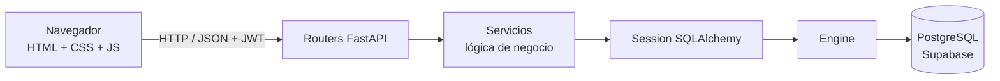

# Arquitectura

## Visión general

Aplicación web de una sola pieza: un backend **FastAPI** que expone una API REST y, además, sirve el
frontend (páginas HTML, CSS y JavaScript) desde la misma URL. Eso evita configurar CORS y un segundo servicio.

## Esquema SQLAlchemy de la materia

| Componente del esquema | Implementación |
|---|---|
| Aplicación Python | FastAPI (`app/main.py`), routers y servicios |
| SQLAlchemy ORM | Mapeo declarativo con `registry` (`app/db/registry.py`) |
| Session | `SessionLocal` y la dependencia `get_db` (`app/database.py`): una sesión por pedido |
| Engine | `create_engine(DATABASE_URL)` (`app/database.py`) |
| Base de datos | PostgreSQL gestionado en Supabase |
| Modelos | Clases en `app/models/`, decoradas con `@mapper_registry.mapped` |
| Metadata | `mapper_registry.metadata`: conoce todas las tablas |
| Tablas | Se crean con `metadata.create_all` (`scripts/create_tables.py`) |

## Capas

- **Routers** (`app/routers`): reciben el pedido HTTP, validan los permisos con dependencias y traducen
  los errores del negocio a códigos HTTP. No contienen lógica.
- **Servicios** (`app/services`): reglas de negocio y consultas. Cada operación hace un único `commit`;
  si algo falla se hace `rollback`, así nunca queda información a medias.
- **Esquemas** (`app/schemas`): modelos Pydantic que validan lo que entra (formatos, rangos) y dan forma a lo que sale.
- **Modelos** (`app/models`): tablas, claves foráneas, restricciones y políticas `ON DELETE`.

Los servicios de estadísticas, historial, peso y racha reciben un `usuario_id` (no el usuario logueado).
Gracias a eso el personal trainer los reutiliza sobre un cliente, una vez verificado el permiso.

## Seguridad

- **Contraseñas** con bcrypt. Nunca se guardan ni se devuelven en texto plano.
- **Sesión** con JWT firmado (HS256, 60 minutos). El cliente lo guarda en el navegador y lo envía en cada pedido.
- **Roles:** `USUARIO` y `PERSONAL_TRAINER`, controlados en el backend con la dependencia `require_role`.
- **Acceso a clientes:** todas las rutas de un trainer sobre un cliente pasan por una única dependencia
  (`cliente_autorizado`). Solo una relación **ACTIVA** da acceso; en cualquier otro caso responde 404,
  como si la persona no existiera.
- **Propiedad de los datos:** los recursos de otra persona (rutinas, entrenamientos, ejercicios propios, etc.)
  responden 404. La única excepción es el trainer que armó la rutina de un cliente activo.
- **Privacidad:** el trainer ve datos básicos, entrenamientos, rutinas, peso y estadísticas de sus clientes.
  No ve su hidratación, fecha de nacimiento ni género.

## Patrones de diseño

- **Factory** (RNF-06): `EjercicioFactory` centraliza cómo se construye un ejercicio del catálogo y uno
  personal. `require_role(...)` es además una fábrica de dependencias: agregar un rol nuevo no obliga a
  modificar el código existente.
- **Observer** (RF-12): `HistorialEntrenamientos` (sujeto) notifica a sus observadores cuando una persona
  finaliza un entrenamiento. `ObservadorActividadTrainer` registra una novedad para el trainer vinculado.
  Se agregan observadores sin tocar el servicio de entrenamientos (`eventos.py`, `observadores.py`).

## Integridad de los datos

- Claves foráneas con política explícita: `CASCADE` para lo que depende de una persona, `SET NULL` para
  lo que debe sobrevivir (por ejemplo, el historial cuando se elimina una rutina) y `RESTRICT` para
  ejercicios con uso.
- Índices únicos parciales en PostgreSQL: un solo entrenamiento en curso por persona y un solo entrenador
  vigente por cliente.
- Restricción única de un registro de peso por persona y día.
- Fechas en hora de Argentina (`America/Argentina/Buenos_Aires`), para que el servidor en UTC no corra los días.

## Frontend

Páginas estáticas con JavaScript sin framework. Componentes reutilizables: selector de ejercicios,
buscador, widgets de racha, hidratación y entrenador. Los gráficos usan Chart.js. El diseño es *mobile-first*.

## Limitaciones conocidas y decisiones de alcance

- **Registro con Google, pagos con Mercado Pago y PWA** quedaron fuera del MVP por decisión del equipo.
  La cuota y los pagos se registran a mano por el trainer.
- El token JWT no se puede invalidar antes de su vencimiento: cambiar la contraseña no cierra otras sesiones abiertas.
- No hay recuperación de contraseña por email ni verificación de correo.
- No hay límite de intentos de inicio de sesión.
- La racha y el historial de hidratación se calculan con la meta vigente, no con la de cada fecha pasada.
- Las tablas se crean con `create_all`: los cambios de columnas sobre una base existente requieren un script
  de migración (como `scripts/migrar_etapa_8.py`).