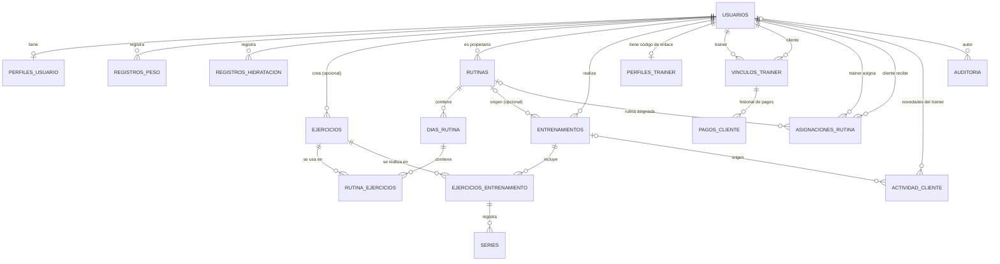

# Modelo de datos

## Diagrama

## Tablas

| Tabla | Contenido |
|---|---|
| `usuarios` | Cuenta: nombre, email único, contraseña hasheada, rol (`USUARIO` o `PERSONAL_TRAINER`) |
| `perfiles_usuario` | Datos físicos y de hidratación (1 a 1 con el usuario) |
| `registros_peso` | Un peso por persona y día (único por `usuario_id` y `fecha`) |
| `registros_hidratacion` | Cada toma de agua, con fecha y mililitros |
| `ejercicios` | Catálogo: tipo de medición (`REPETICIONES`/`TIEMPO`), uso de peso corporal, creador (base o propio) |
| `rutinas` | Nombre, descripción, `autor_id` (quién la armó) y `propietario_id` (quién la usa) |
| `dias_rutina` | Día de la semana y nombre del entrenamiento |
| `rutina_ejercicios` | Ejercicio de un día: fuerza con series/repeticiones o duración sugerida en segundos; peso/descanso opcionales |
| `entrenamientos` | Sesión: título copiado, fecha, inicio y fin, duración, dificultad, cansancio, ánimo, agua, estado |
| `ejercicios_entrenamiento` | Ejercicio realizado en una sesión, con notas |
| `series` | Registro realizado: fuerza con peso/repeticiones (peso corporal copiado al guardar) o duración en segundos; completado |
| `perfiles_trainer` | Código de enlace del trainer |
| `vinculos_trainer` | Relación entrenador-cliente: estado, estado de la cuota, fechas de inicio y fin |
| `pagos_cliente` | Historial de pagos de una relación |
| `asignaciones_rutina` | Rutina asignada a un cliente: fecha y estado |
| `actividad_cliente` | Novedades del panel del trainer, generadas por el Observer |
| `auditoria` | Quién hizo qué y cuándo (rutinas, relaciones, pagos, cuenta) |

## Estados

- **Relación entrenador-cliente:** `PENDIENTE` → `ACTIVA` → `FINALIZADA`.
- **Cuota:** `AL_DIA`, `PENDIENTE`, `VENCIDA`.
- **Asignación de rutina:** `ACTIVA`, `FINALIZADA`.
- **Entrenamiento:** `EN_CURSO`, `FINALIZADO`.

## Políticas de borrado

| Relación | Al eliminar el registro padre |
|---|---|
| Perfil, pesos, hidratación, rutinas (propietario) y entrenamientos de una persona | Se eliminan con la persona (`CASCADE`) |
| Días y ejercicios de una rutina; ejercicios y series de un entrenamiento | Se eliminan con su padre (`CASCADE`) |
| `entrenamientos.rutina_id` | Queda vacío (`SET NULL`): el historial sobrevive a la rutina (RF-10) |
| `rutinas.autor_id`, `ejercicios.creador_id` | Quedan vacíos (`SET NULL`) |
| `rutina_ejercicios.ejercicio_id`, `ejercicios_entrenamiento.ejercicio_id` | Impide borrar el ejercicio (`RESTRICT`) |
| Relación, pagos, asignaciones y novedades | Se eliminan con cualquiera de las dos personas (`CASCADE`) |
| `asignaciones_rutina.rutina_id`, `actividad_cliente.entrenamiento_id`, `auditoria.usuario_id` | Quedan vacíos (`SET NULL`) |

## Restricciones notables

- Un solo `entrenamiento` en estado `EN_CURSO` por persona (índice único parcial).
- Un solo `vinculo_trainer` vigente (`PENDIENTE` o `ACTIVA`) por cliente (índice único parcial).
- Un `registro_peso` por persona y día.
- Código de enlace del trainer único.
- Los enumerados se guardan como texto, no como tipo nativo de PostgreSQL: sumar un valor no exige alterar el tipo.

## Medición de ejercicios

- `ejercicios.tipo_medicion = REPETICIONES`: usa series y repeticiones.
- `ejercicios.tipo_medicion = TIEMPO`: usa un único registro de duración por ejercicio, guardado en segundos. La interfaz permite ingresarlo en minutos. Se utiliza para cardio y también puede aplicarse a ejercicios isométricos creados por tiempo.
- `ejercicios.usa_peso_corporal = true`: al guardar una serie se toma `perfiles_usuario.peso_actual_kg` y se copia en `series.peso_kg`. Ese valor queda como fotografía histórica aunque después cambie el perfil.
- En ejercicios por tiempo, `series.repeticiones` y `series.peso_kg` quedan en `NULL`; no suman volumen. Las series de fuerza mantienen el cálculo `peso × repeticiones`.
- Las columnas nuevas tienen valores predeterminados compatibles con los registros anteriores: los ejercicios ya existentes continúan como `REPETICIONES` y sin peso corporal automático.